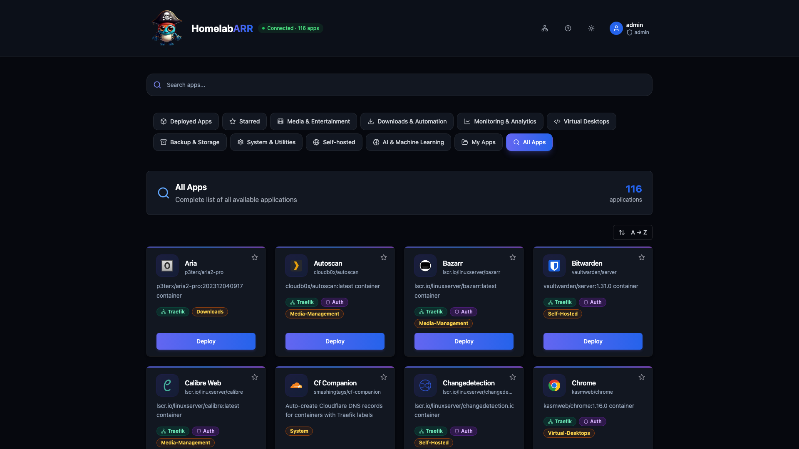

# HomelabARR

<p align="center">
    <a href="https://github.com/imogenlabs/homelabarr-ce">
      
    </a>
</p>

<p align="center"><strong>Your homelab, one dashboard.</strong></p>

<p align="center">
    <a href="https://github.com/imogenlabs/homelabarr-ce/releases/latest"></a>
    <a href="LICENSE"></a>
    <a href="https://demo.homelabarr.com"></a>
    <a href="https://wiki.homelabarr.com"></a>
    <a href="https://discord.gg/Pc7mXX786x"></a>
</p>

HomelabARR is a dashboard for self-hosted apps. Open it, pick from 118 apps, click **Deploy**, and the app is running. No hunting for Compose files, no editing YAML, no guessing at ports.

Plex, Jellyfin, Sonarr, Radarr, qBittorrent, Ollama, Home Assistant, Immich and more are ready to go. It's free and open source under the MIT license, with no account and no telemetry.

<p align="center">
    
</p>

**Try it first:** the [live demo](https://demo.homelabarr.com) logs in with `admin` / `admin` and resets every 30 minutes.

## Quick start

You need a Linux machine with Docker and `setfacl` (the `acl` package). No Docker yet? Run `curl -fsSL https://get.docker.com | sh` first.

```bash
# 1. Clone
git clone https://github.com/imogenlabs/homelabarr-ce.git /opt/homelabarr
cd /opt/homelabarr

# 2. Create the secrets (the initial admin password is printed)
bash scripts/init-secrets.sh

# 3. Set the dashboard address. It opens at plain http://<ip>:8084, so also
#    allow plain HTTP (skip that line if an HTTPS reverse proxy sits in front)
export CORS_ORIGIN=http://$(hostname -I | awk '{print $1}'):8084
export ALLOW_PLAIN_HTTP=true

# 4. Install the AppArmor profiles (AppArmor hosts only), then start
sudo bash scripts/install-apparmor.sh
docker compose -f homelabarr.yml up -d
```

Open `http://your-server-ip:8084`. Log in as `admin` with the password printed by `scripts/init-secrets.sh` (also saved in `./secrets/default_admin_password`), then change it.

- **HTTPS:** behind Traefik, Caddy or another HTTPS proxy, leave out `ALLOW_PLAIN_HTTP` and set `CORS_ORIGIN` to your `https://` address. Only use `ALLOW_PLAIN_HTTP=true` on a network you trust.
- **Keep the settings:** put `CORS_ORIGIN` (and `ALLOW_PLAIN_HTTP`) in a `.env` file next to `homelabarr.yml`.
- **Update:** from the HomelabARR folder, `git pull && sudo bash scripts/install-apparmor.sh`, then `docker compose -f homelabarr.yml pull && docker compose -f homelabarr.yml up -d`. Re-running the AppArmor script picks up profile changes; on hosts without AppArmor it does nothing.

More options and building from source: [install guide](https://wiki.homelabarr.com/guides/quick-start/).

## What you get

- **118 apps, one click each:** media servers and managers, download clients, AI tools, monitoring, virtual desktops, backup and more.
- **Your choice of exposure:** plain IP and port, Traefik with SSL, or Traefik with Authelia for two-factor login.
- **Container management:** start, stop, restart, remove and read logs.
- **Port Manager:** every port in use across your stack.
- **Your own apps:** drop a Compose YAML file in `apps/myapps/`.
- **Mobile app:** manage your homelab from your phone.

Every app is a plain Compose file in `apps/<category>/`. Read it, change it, or write your own.

## How it works

Three containers:

| Service | Role |
|---------|------|
| **Frontend** | The dashboard, served by nginx on port 8084. |
| **Backend** | Reads the app catalog, deploys apps and handles sign-in. |
| **Socket proxy** | The only thing that touches Docker. It allows listing, starting, stopping and log reads, and refuses exec and image builds. |

Details: [architecture](https://wiki.homelabarr.com/guides/architecture/).

## Security

- Sign-in with two-factor (TOTP), rate limiting and account lockout.
- An encrypted database, and a tamper-evident audit log.
- Hardened containers: read-only, no extra privileges, AppArmor profiles.
- Signed images with an SBOM, scanned for vulnerabilities on every build.

Verify an image before you run it:

```bash
cosign verify \
  --certificate-identity-regexp '^https://github.com/imogenlabs/homelabarr-ce/' \
  --certificate-oidc-issuer https://token.actions.githubusercontent.com \
  ghcr.io/imogenlabs/homelabarr-backend:latest
```

Found a vulnerability? See [SECURITY.md](SECURITY.md). The [threat model](docs/threat-model/README.md) and [audit history](docs/audit/README.md) are in `docs/`.

## Settings

| Setting | Default | What it does |
|---------|---------|--------------|
| `CORS_ORIGIN` | required | The address you open the dashboard at. |
| `ALLOW_PLAIN_HTTP` | `false` | Allow sign-in at a plain `http://` address. LAN only. |
| `FRONTEND_PORT` | `8084` | Dashboard port. |
| `TRUST_PROXY_HOPS` | `1` | Proxies in front of the backend. Raise it only if you add your own reverse proxy. |

All settings: [configuration](https://wiki.homelabarr.com/guides/configuration/).

## Contributing

Bug reports, app requests and pull requests are welcome. See [CONTRIBUTING.md](CONTRIBUTING.md) for the development setup and tests.

## Community

[Website](https://homelabarr.com) · [Docs](https://wiki.homelabarr.com) · [Discord](https://discord.gg/Pc7mXX786x) · [r/homelabarr](https://www.reddit.com/r/homelabarr/) · Made by [Imogen Labs](https://imogenlabs.ai)

## License

[MIT](LICENSE)
