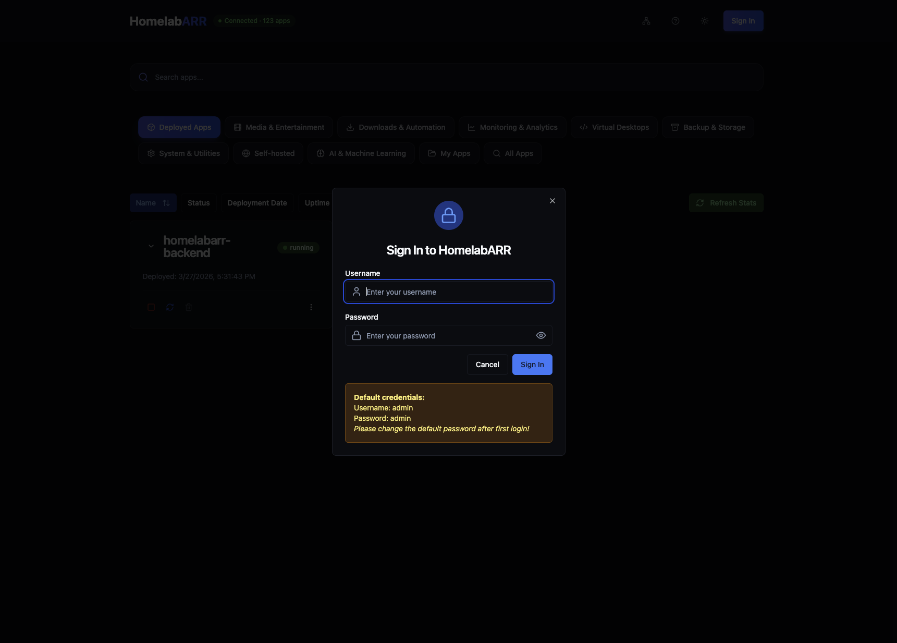
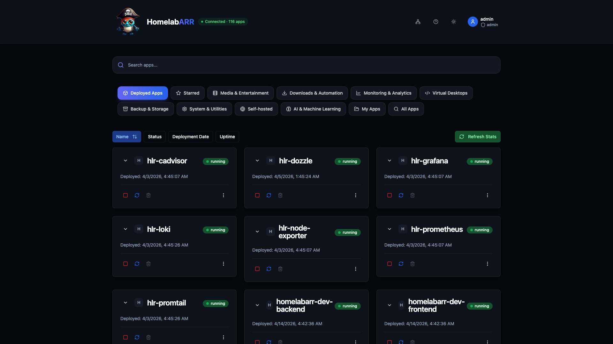

# Quick Start

Get HomelabARR CE running on your server. Pick one of the two install methods below and follow every step in order.

---

## Before You Start

You need a Linux server with Docker installed. That's it.

**Don't have Docker yet?** Run this on your server:

```bash
curl -fsSL https://get.docker.com | sh
```

This is the official Docker installer script — you can [review the source](https://github.com/docker/docker-install) before running it if you prefer. It downloads and installs Docker Engine and Compose v2 on most Linux distributions.

Wait for it to finish. Then add your user to the Docker group so you don't need `sudo` for everything:

```bash
sudo usermod -aG docker $USER
```

**Log out and back in** for that to take effect. Then verify it worked:

```bash
docker --version
docker compose version
```

If both commands print a version number, you're good. If not, check the [Docker docs](https://docs.docker.com/engine/install/).

---

!!! tip "Before you expose this to the internet"
    Read the [Security](security.md) guide to understand what ships by default and how to verify the security envelope on your deployment.

## Method 1: Docker Compose (Recommended)

This is the fastest way to get up and running. Copy and paste these commands one at a time.

### Step 1: Clone the repo

```bash
git clone https://github.com/imogenlabs/homelabarr-ce.git /opt/homelabarr
```

This downloads the entire repo — including all 100+ app templates — to `/opt/homelabarr`. The `apps/` folder inside is what makes the catalog work. **Don't skip this step.**

### Step 2: Go into the folder

```bash
cd /opt/homelabarr
```

### Step 3: Create the secrets

HomelabARR reads its signing keys and the first admin password from files in `./secrets/`. Create them before anything else:

```bash
bash scripts/init-secrets.sh
```

It prints the **initial admin password** at the end. Keep it handy for Step 6. (It's also saved in `./secrets/default_admin_password`.)

!!! warning "Don't skip this step"
    Without `./secrets/`, `docker compose up` stops right away with `bind source path does not exist: .../secrets/jwt_key_previous`. If you see that, run `bash scripts/init-secrets.sh` and start again.

The script needs `setfacl`. If it says to install the `acl` package, run `sudo apt-get install -y acl` (Debian/Ubuntu) and try again.

### Step 4: Set your dashboard address and start HomelabARR

```bash
export CORS_ORIGIN=http://YOUR-SERVER-IP:8084
export ALLOW_PLAIN_HTTP=true
```

!!! warning "Replace YOUR-SERVER-IP — both times"
    Change `YOUR-SERVER-IP` to your server's IP address in the `CORS_ORIGIN` line, and again when you open the dashboard in Step 5. For example: `http://192.0.2.100:8084`

    Don't know your server's IP? Run `hostname -I` and use the first address shown.

What these do:

- **CORS_ORIGIN** tells the backend which address your browser uses. It must match exactly: same `http`/`https`, IP or hostname, and port.
- **ALLOW_PLAIN_HTTP** lets you log in at a plain `http://` address. Without it, the login cookie is HTTPS-only and the browser throws it away, so you land back on the login screen. Only use it on a network you trust. If you put HomelabARR behind an HTTPS reverse proxy (Traefik, Caddy, Nginx Proxy Manager), leave it out and set `CORS_ORIGIN` to your `https://` address.

!!! tip "Persist with a .env file"
    These `export` commands only last until you close your terminal. To make them permanent, put them in a `.env` file next to `homelabarr.yml`. See the [Configuration guide](configuration.md) for details.

On hosts with AppArmor (Ubuntu, Debian, Proxmox), install the HomelabARR profiles first, then start:

```bash
sudo bash scripts/install-apparmor.sh
docker compose -f homelabarr.yml up -d
```

Docker will download the images (this takes a minute or two the first time) and start everything up.

### Step 5: Open the dashboard

Open your web browser and go to:

```
http://YOUR-SERVER-IP:8084
```

You should see the HomelabARR dashboard with 100+ apps ready to deploy.

### Step 6: Log in and change your password

Click **Sign In** in the top right corner.

- **Username:** `admin`
- **Password:** the one `scripts/init-secrets.sh` printed in Step 3 (also in `./secrets/default_admin_password`)



!!! danger "Change this now"
    The initial password sits in a file on your server. After signing in, click your username in the top right and set a new password before doing anything else.

### Step 7: Deploy your first app

1. Pick any app from the catalog — try **Plex**, **Jellyfin**, or **Portainer** to start
2. Click the blue **Deploy** button on the app card
3. Choose a deployment mode:
    - **Standard** — the simple option. The app gets a port, you access it at `http://YOUR-SERVER-IP:PORT`. No extra setup needed. **Pick this if you're not sure.**
    - **Traefik** — gives the app a real URL like `https://plex.yourdomain.com` with SSL. Requires a domain and Traefik. ([Setup guide](traefik-setup.md))
    - **Traefik + Authelia** — same as Traefik but adds a login page in front of the app
4. Click **Deploy** and watch it install in real time



Your app is running. You can find it at `http://YOUR-SERVER-IP:PORT` — the port number is shown in the app card.

---

## Method 2: One-Line Install

Prefer an interactive guided setup? The install script handles everything:

```bash
curl -fsSL https://raw.githubusercontent.com/imogenlabs/homelabarr-ce/main/install-remote.sh | sudo bash
```

!!! info "What this script does"
    You can [review the script](https://github.com/imogenlabs/homelabarr-ce/blob/main/install-remote.sh) before running it. It will ask you interactively for your timezone, user ID, and data paths — nothing happens without your input.

The script will:

1. Check for Docker (and install it if missing)
2. Clone the repo to `/opt/homelabarr`
3. Walk you through setting your timezone, user ID, and data paths
4. Configure Docker networks
5. Start HomelabARR

→ [More about the CLI](cli-installation.md)

---

## What Now?

You've got HomelabARR running. Here's what to explore next:

- **Browse the dashboard** — check out all 10 categories of apps
- **[Web Dashboard Guide](web-dashboard.md)** — learn what every button does
- **[Configuration](configuration.md)** — customise ports, paths, and settings
- **Want apps on a custom domain with SSL?** → [Traefik & Domain Setup](traefik-setup.md)

---

## Something Not Working?

### I see the dashboard but no apps load

Make sure you cloned the repo in Step 1. The app templates live in the `apps/` folder — without them, the dashboard has nothing to show.

### I get a CORS error or the API won't connect

The `CORS_ORIGIN` variable needs to match **exactly** how you access the dashboard in your browser.

```bash
# If you access it at http://192.0.2.100:8084, set:
export CORS_ORIGIN=http://192.0.2.100:8084

# Then restart:
docker compose -f homelabarr.yml up -d
```

### I log in, then land straight back on the login screen

Your browser is on a plain `http://` address, but the login cookie is HTTPS-only, so the browser discards it. Either serve the dashboard over HTTPS, or (on a trusted LAN) allow plain HTTP and restart:

```bash
export ALLOW_PLAIN_HTTP=true
docker compose -f homelabarr.yml up -d
```

The backend log says so too: look for `Login from a plain-HTTP page` in `docker logs homelabarr-backend`.

### `docker compose up` fails with "bind source path does not exist: .../secrets/..."

The secret files haven't been created yet. Run `bash scripts/init-secrets.sh` from `/opt/homelabarr`, then start again.

### Containers won't deploy — Docker connection error

The backend talks to Docker through the bundled `socket-proxy` container at `tcp://socket-proxy:2375`, so the backend itself doesn't need the Docker socket. Check that the proxy is healthy:

```bash
docker ps --filter name=homelabarr-socket-proxy
docker logs homelabarr-socket-proxy
```

### Permission denied on `/opt/appdata`

Some apps store data in `/opt/appdata`. Create it with the right permissions:

```bash
sudo mkdir -p /opt/appdata
sudo chown -R $USER:$USER /opt/appdata
```

### Running in a Proxmox LXC container?

Docker inside LXC needs AppArmor disabled. On your **Proxmox host** (not inside the container), run:

```bash
echo 'lxc.apparmor.profile: unconfined' >> /etc/pve/lxc/YOUR-VMID.conf
```

Replace `YOUR-VMID` with your container's ID number (like `100` or `999`). Then restart the container from the Proxmox UI.
